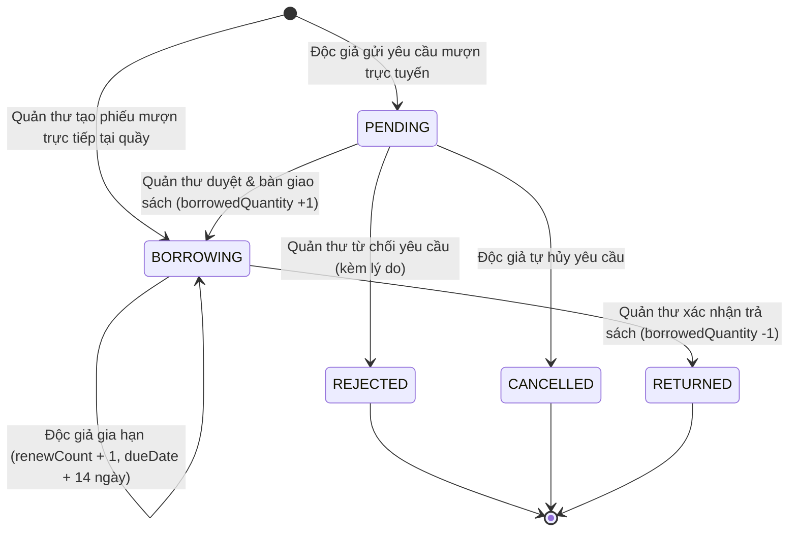

# Bản Đặc Tả Kỹ Thuật Nghiệp Vụ Quản Lý Mượn Trả Sách (Borrow Management Spec)

> **Mã tài liệu:** `SPEC-BORROW-01`  
> **Phiên bản:** `1.0.0`  
> **Trạng thái:** `Đã phê duyệt / Sẵn sàng triển khai & Kiểm thử`  
> **Căn cứ hệ thống:** Prisma Schema (`server/prisma/schema.prisma`), Backend Modules (`server/src/borrow/`), GEMINI.md  

---

## 1. Mục Tiêu Nghiệp Vụ (Business Goals & Scope)

### 1.1 Vấn đề nghiệp vụ
Thư viện cần số hóa toàn diện quy trình mượn, trả và gia hạn sách nhằm:
- Loại bỏ việc ghi chép sổ sách thủ công, tránh thất thoát hoặc chênh lệch số lượng tồn kho.
- Cho phép bạn đọc (Độc giả - `MEMBER`) chủ động tìm kiếm, gửi yêu cầu mượn sách trực tuyến và theo dõi lịch sử mượn trả cá nhân.
- Cung cấp công cụ cho Quản thư (`STAFF`) và Quản trị viên (`ADMIN`) thẩm định, phê duyệt giao sách, xử lý mượn trực tiếp tại quầy, thu hồi sách và xử lý sách quá hạn.
- Đảm bảo tính toán chính xác giá trị tài sản sách trong kho và sách đang lưu hành ngoài thư viện.

### 1.2 Phạm vi nghiệp vụ (Scope)
- **Trong phạm vi (In-Scope):**
  - Độc giả gửi yêu cầu mượn sách trực tuyến (trạng thái `PENDING`).
  - Độc giả tự hủy yêu cầu mượn khi yêu cầu chưa được xử lý.
  - Quản thư phê duyệt (`BORROWING`) hoặc từ chối (`REJECTED`) yêu cầu mượn.
  - Quản thư tạo phiếu mượn trực tiếp tại quầy cho bạn đọc.
  - Độc giả tự thực hiện gia hạn sách (tối đa 1 lần nếu chưa quá hạn).
  - Quản thư tiếp nhận hoàn trả sách (`RETURNED`) và cập nhật hoàn kho.
  - Kiểm soát giới hạn: tối đa 5 cuốn sách mượn/chờ mượn cùng lúc trên mỗi bạn đọc; chặn mượn khi có sách quá hạn; thời hạn mượn mặc định 14 ngày.
- **Ngoài phạm vi hiện tại (Out of Scope):**
  - Tích hợp cổng thanh toán trực tuyến tính phí phạt quá hạn (chỉ ghi nhận trạng thái quá hạn qua ngày trả).
  - Quản lý bồi thường khi sách rách nát/mất sách (xử lý thủ công qua ghi chú).

---

## 2. Mô Hình Dữ Liệu & Vòng Đời Trạng Thái (BorrowStatus Lifecycle)

### 2.1 Cấu trúc thực thể liên quan (Data Model)

Căn cứ từ `schema.prisma`:

```prisma
enum Role {
  ADMIN
  STAFF
  MEMBER
}

enum BorrowStatus {
  PENDING
  BORROWING
  RETURNED
  REJECTED
  CANCELLED
}

model BorrowRecord {
  id            Int          @id @default(autoincrement())
  borrowerName  String
  borrowerCode  String
  userId        Int?         // Khóa ngoại liên kết User (MEMBER)
  bookId        Int          // Khóa ngoại liên kết Book
  borrowedAt    DateTime     @default(now())
  dueDate       DateTime     // Hạn trả dự kiến
  returnedAt    DateTime?    // Thời điểm thực tế trả sách
  status        BorrowStatus @default(PENDING)
  notes         String?      // Ghi chú từ người mượn hoặc thủ thư
  rejectReason  String?      // Lý do từ chối (nếu REJECTED)
  renewCount    Int          @default(0) // Số lần đã gia hạn (tối đa 1)
  processedById Int?         // Nhân viên/Admin thao tác duyệt/trả sách
  createdAt     DateTime     @default(now())
  updatedAt     DateTime     @updatedAt

  user        User? @relation("MemberBorrowRecords", fields: [userId], references: [id], onDelete: SetNull)
  book        Book  @relation(fields: [bookId], references: [id], onDelete: Restrict)
  processedBy User? @relation("StaffBorrowRecords", fields: [processedById], references: [id], onDelete: SetNull)

  @@index([bookId])
  @@index([borrowerCode])
  @@index([userId])
  @@index([processedById])
  @@index([status])
}
```

#### Tác động đến thực thể `Book`:
- `Book.quantity`: Tổng số lượng sách trong thư viện.
- `Book.borrowedQuantity`: Số lượng cuốn đang cho mượn (chỉ tăng khi phiếu ở trạng thái `BORROWING`).
- Số lượng khả dụng cho mượn thực tế:  
  $$\text{AvailableQuantity} = \text{Book.quantity} - \text{Book.borrowedQuantity}$$

---

### 2.2 Định nghĩa các trạng thái (`BorrowStatus`)

| Trạng thái | Mã định danh | Ý nghĩa nghiệp vụ | Tác động tồn kho `Book.borrowedQuantity` |
| :--- | :--- | :--- | :--- |
| **Chờ duyệt** | `PENDING` | Độc giả tạo yêu cầu qua Web/App, chưa nhận sách thực tế. | Không đổi (chưa tính vào `borrowedQuantity`). |
| **Đang mượn** | `BORROWING` | Sách đã giao tới tay bạn đọc (do Quản thư duyệt hoặc mượn tại quầy). | **+1** (Tăng số lượng mượn khi duyệt/tạo). |
| **Đã trả** | `RETURNED` | Bạn đọc đã mang sách trả quầy, Quản thư xác nhận nhập lại kho. | **-1** (Giảm số lượng mượn về kho). |
| **Từ chối** | `REJECTED` | Quản thư từ chối yêu cầu mượn kèm lý do giải trình. | Không đổi. |
| **Đã hủy** | `CANCELLED` | Độc giả chủ động hủy yêu cầu khi phiếu vẫn còn `PENDING`. | Không đổi. |

---

### 2.3 Sơ đồ chuyển đổi trạng thái (State Machine Diagram)



#### Ma trận chuyển trạng thái hợp lệ:

| Từ trạng thái | Đến trạng thái | Người thực hiện | Điều kiện ràng buộc |
| :--- | :--- | :--- | :--- |
| `[Mới]` | `PENDING` | `MEMBER`, `STAFF`, `ADMIN` | Sách còn khả dụng (>0), không có sách quá hạn, <5 cuốn đang mượn. |
| `[Mới]` | `BORROWING` | `STAFF`, `ADMIN` | Tạo trực tiếp tại quầy, sách còn khả dụng (>0), ngày hẹn trả hợp lệ. |
| `PENDING` | `BORROWING` | `STAFF`, `ADMIN` | Sách vẫn còn khả dụng tại thời điểm duyệt. |
| `PENDING` | `REJECTED` | `STAFF`, `ADMIN` | Có thể nhập lý do từ chối. |
| `PENDING` | `CANCELLED` | `MEMBER` (chính chủ) | Chỉ khi phiếu đang `PENDING`. |
| `BORROWING` | `BORROWING` (Gia hạn) | `MEMBER` (chính chủ) | `renewCount == 0` và `dueDate >= now` (chưa quá hạn). |
| `BORROWING` | `RETURNED` | `STAFF`, `ADMIN` | Chỉ áp dụng cho phiếu đang `BORROWING`. |

---

## 3. Quy Tắc Nghiệp Vụ Chi Tiết (Business Workflows & Rules)

### 3.1 Quy tắc giới hạn chung
1. **Hạn mức mượn đồng thời (`MAX_ACTIVE_BORROWS_PER_USER`):**
   - Mỗi độc giả chỉ được có **tối đa 5 cuốn sách** ở trạng thái đang giữ (`PENDING` hoặc `BORROWING`).
   - Nếu vượt quá 5 cuốn, hệ thống từ chối yêu cầu mượn mới.
2. **Kiểm tra nợ sách quá hạn:**
   - Nếu độc giả có bất kỳ cuốn sách nào đang mượn (`status = BORROWING`) có `dueDate < Thời điểm hiện tại`, hệ thống **khóa quyền mượn sách mới** cho đến khi sách quá hạn được hoàn trả.
3. **Chống mượn trùng cuốn sách:**
   - Một độc giả không thể gửi yêu cầu mượn cuốn sách `X` nếu họ đang có một yêu cầu `PENDING` hoặc đang mượn cuốn `X` ở trạng thái `BORROWING`.
4. **Thời hạn mượn mặc định (`DEFAULT_BORROW_DAYS`):**
   - Thời hạn mượn tiêu chuẩn là **14 ngày** kể từ thời điểm duyệt giao sách (`borrowedAt`).
5. **Quy tắc gia hạn sách (`RENEW_DAYS`):**
   - Mỗi phiếu mượn chỉ được phép gia hạn **tối đa 1 lần** (`renewCount = 0 -> 1`).
   - Mỗi lần gia hạn cộng thêm **14 ngày** vào `dueDate` hiện tại:  
     $$\text{NewDueDate} = \text{OldDueDate} + 14\text{ ngày}$$
   - **Tuyệt đối không cho phép gia hạn nếu sách đã quá hạn** (`dueDate < now`). Bạn đọc phải mang sách đến quầy để kiểm tra và xử lý trực tiếp.
6. **Bảo toàn dữ liệu tồn kho (Concurrency & Atomic Transaction):**
   - Thao tác tăng/giảm `borrowedQuantity` trên bảng `Book` bắt buộc phải đặt trong Database Transaction với câu điều kiện kiểm tra tồn kho nguyên tử nhằm chống tranh chấp tài nguyên (Race Condition).

---

## 4. Đặc Tả Danh Sách API Endpoints

Toàn bộ API được triển khai tại tiền tố: `/api/v1/borrows`  
Yêu cầu Header bảo mật: `Authorization: Bearer <access_token>`

### 4.1 Độc giả gửi yêu cầu mượn sách trực tuyến
- **Endpoint:** `POST /api/v1/borrows/request`
- **Quyền hạn:** `MEMBER`, `STAFF`, `ADMIN`
- **Request Body (JSON):**
  ```json
  {
    "bookId": 12,
    "notes": "Mượn phục vụ làm đề tài tốt nghiệp"
  }
  ```
- **Xử lý:**
  - Kiểm tra `activeBorrowCount < 5`.
  - Kiểm tra không có sách quá hạn.
  - Kiểm tra chưa mượn trùng `bookId`.
  - Kiểm tra `quantity - borrowedQuantity > 0`.
  - Tạo `BorrowRecord` với `status: PENDING`, `dueDate: now + 14 days`.
- **Response thành công (`201 Created`):**
  ```json
  {
    "message": "Gửi yêu cầu mượn sách thành công. Vui lòng chờ thư viện phê duyệt.",
    "data": {
      "id": 101,
      "borrowerName": "Nguyễn Văn A",
      "borrowerCode": "MB-00012",
      "userId": 12,
      "bookId": 12,
      "borrowedAt": "2026-10-19T10:00:00.000Z",
      "dueDate": "2026-11-02T10:00:00.000Z",
      "status": "PENDING",
      "notes": "Mượn phục vụ làm đề tài tốt nghiệp",
      "renewCount": 0
    }
  }
  ```
- **Mã lỗi thường gặp:**
  - `400 Bad Request`: Vượt quá số lượng cho phép, có sách quá hạn, đã gửi yêu cầu sách này trước đó, hoặc sách đã hết bản sao.
  - `404 Not Found`: Không tìm thấy sách (`bookId`).

---

### 4.2 Lấy danh sách phiếu mượn cá nhân (Độc giả)
- **Endpoint:** `GET /api/v1/borrows/my-borrows`
- **Quyền hạn:** `MEMBER`, `STAFF`, `ADMIN`
- **Query Parameters:**
  - `page`: số trang (mặc định 1)
  - `limit`: số bản ghi/trang (mặc định 10)
  - `search`: tìm theo tên sách, ISBN
  - `status`: lọc theo `BorrowStatus` (`PENDING`, `BORROWING`, `RETURNED`, v.v.)
- **Response thành công (`200 OK`):**
  ```json
  {
    "data": [
      {
        "id": 101,
        "borrowerName": "Nguyễn Văn A",
        "borrowerCode": "MB-00012",
        "status": "PENDING",
        "borrowedAt": "2026-10-19T10:00:00.000Z",
        "dueDate": "2026-11-02T10:00:00.000Z",
        "renewCount": 0,
        "book": {
          "id": 12,
          "title": "Clean Code",
          "isbn": "978-0132350884",
          "author": "Robert C. Martin",
          "coverImage": "/uploads/clean-code.jpg"
        }
      }
    ],
    "pagination": {
      "page": 1,
      "limit": 10,
      "total": 1,
      "totalPages": 1
    }
  }
  ```

---

### 4.3 Độc giả hủy yêu cầu mượn sách
- **Endpoint:** `PATCH /api/v1/borrows/:id/cancel`
- **Quyền hạn:** `MEMBER`, `STAFF`, `ADMIN` (phải là chủ sở hữu bản ghi)
- **Xử lý:**
  - Kiểm tra `record.userId === req.user.id`.
  - Kiểm tra `record.status === PENDING`.
  - Cập nhật `status = CANCELLED`.
- **Response thành công (`200 OK`):**
  ```json
  {
    "message": "Hủy yêu cầu mượn sách thành công.",
    "data": {
      "id": 101,
      "status": "CANCELLED"
    }
  }
  ```
- **Mã lỗi:**
  - `403 Forbidden`: Người dùng khác cố gắng hủy phiếu không phải của mình.
  - `400 Bad Request`: Phiếu không ở trạng thái `PENDING` (ví dụ: đã được duyệt hoặc đã trả).

---

### 4.4 Độc giả gia hạn thời gian mượn sách
- **Endpoint:** `PATCH /api/v1/borrows/:id/renew`
- **Quyền hạn:** `MEMBER`, `STAFF`, `ADMIN` (chính chủ bản ghi)
- **Xử lý:**
  - Kiểm tra quyền sở hữu (`userId`).
  - Kiểm tra `status === BORROWING`.
  - Kiểm tra `renewCount < 1` (chưa từng gia hạn).
  - Kiểm tra `dueDate >= now` (chưa bị quá hạn).
  - Tăng `renewCount` lên 1, cộng thêm 14 ngày vào `dueDate`.
- **Response thành công (`200 OK`):**
  ```json
  {
    "message": "Gia hạn sách thành công thêm 14 ngày.",
    "data": {
      "id": 101,
      "status": "BORROWING",
      "dueDate": "2026-11-16T10:00:00.000Z",
      "renewCount": 1
    }
  }
  ```
- **Mã lỗi:**
  - `400 Bad Request`: Sách đã gia hạn 1 lần hoặc sách đã bị quá hạn trả.

---

### 4.5 Quản thư duyệt yêu cầu & bàn giao sách
- **Endpoint:** `PATCH /api/v1/borrows/:id/approve`
- **Quyền hạn:** `STAFF`, `ADMIN`
- **Xử lý:**
  - Kiểm tra phiếu tồn tại và có `status === PENDING`.
  - Trong transaction: kiểm tra và tăng nguyên tử `Book.borrowedQuantity` (+1).
  - Cập nhật phiếu: `status = BORROWING`, `borrowedAt = now`, `dueDate = now + 14 days`, `processedById = staffId`.
- **Response thành công (`200 OK`):**
  ```json
  {
    "message": "Duyệt yêu cầu và bàn giao sách thành công.",
    "data": {
      "borrowRecord": {
        "id": 101,
        "status": "BORROWING",
        "borrowedAt": "2026-10-19T10:30:00.000Z",
        "dueDate": "2026-11-02T10:30:00.000Z",
        "processedById": 2
      },
      "book": {
        "id": 12,
        "quantity": 10,
        "borrowedQuantity": 3
      }
    }
  }
  ```

---

### 4.6 Quản thư từ chối yêu cầu mượn
- **Endpoint:** `PATCH /api/v1/borrows/:id/reject`
- **Quyền hạn:** `STAFF`, `ADMIN`
- **Request Body (JSON):**
  ```json
  {
    "reason": "Sách bị hư hỏng đang chờ bảo trì, không thể xuất mượn."
  }
  ```
- **Xử lý:** Cập nhật `status = REJECTED`, lưu `rejectReason`, `processedById = staffId`. Không thay đổi số lượng kho.
- **Response thành công (`200 OK`):**
  ```json
  {
    "message": "Đã từ chối yêu cầu mượn sách.",
    "data": {
      "id": 101,
      "status": "REJECTED",
      "rejectReason": "Sách bị hư hỏng đang chờ bảo trì, không thể xuất mượn.",
      "processedById": 2
    }
  }
  ```

---

### 4.7 Quản thư tạo trực tiếp phiếu mượn tại quầy
- **Endpoint:** `POST /api/v1/borrows`
- **Quyền hạn:** `STAFF`, `ADMIN`
- **Request Body (JSON):**
  ```json
  {
    "borrowerName": "Trần Thị B",
    "borrowerCode": "MB-00099",
    "bookId": 12,
    "dueDate": "2026-11-05T17:00:00.000Z"
  }
  ```
- **Xử lý:**
  - Kiểm tra `dueDate > now`.
  - Transaction kiểm tra tồn kho và tăng `Book.borrowedQuantity` (+1).
  - Tạo record với trạng thái `BORROWING` ngay lập tức, gán `processedById = staffId`.
- **Response thành công (`201 Created`):**
  ```json
  {
    "message": "Book borrowed successfully",
    "data": {
      "borrowRecord": {
        "id": 102,
        "borrowerName": "Trần Thị B",
        "borrowerCode": "MB-00099",
        "status": "BORROWING",
        "dueDate": "2026-11-05T17:00:00.000Z",
        "processedById": 2
      }
    }
  }
  ```

---

### 4.8 Lấy danh sách toàn bộ phiếu mượn (Quản trị viên / Thủ thư)
- **Endpoint:** `GET /api/v1/borrows`
- **Quyền hạn:** `STAFF`, `ADMIN`
- **Query Parameters:** `page`, `limit`, `search` (tên độc giả, mã thẻ, tên sách, ISBN), `status`.
- **Response thành công (`200 OK`):** Danh sách phân trang kèm đầy đủ thông tin sách, người mượn, nhân viên xử lý.

---

### 4.9 Quản thư xác nhận hoàn trả sách
- **Endpoint:** `PATCH /api/v1/borrows/:id/return`
- **Quyền hạn:** `STAFF`, `ADMIN`
- **Xử lý:**
  - Kiểm tra phiếu đang ở trạng thái `BORROWING`.
  - Transaction giảm `Book.borrowedQuantity` (-1) với điều kiện `borrowedQuantity > 0`.
  - Cập nhật phiếu: `status = RETURNED`, `returnedAt = now`, `processedById = staffId`.
- **Response thành công (`200 OK`):**
  ```json
  {
    "message": "Book returned successfully",
    "data": {
      "borrowRecord": {
        "id": 101,
        "status": "RETURNED",
        "returnedAt": "2026-10-25T08:15:00.000Z",
        "processedById": 2
      },
      "book": {
        "id": 12,
        "quantity": 10,
        "borrowedQuantity": 2
      }
    }
  }
  ```

---

## 5. Tiêu Chí Nghiệm Thu (Acceptance Criteria & Test Scenarios)

### AC 01: Độc giả tạo yêu cầu mượn sách trực tuyến thành công
- **Given:** Bạn đọc đã đăng nhập với vai trò `MEMBER`, không có sách nào quá hạn, số sách đang mượn/chờ mượn là `< 5`. Cuốn sách có ID `12` còn số lượng khả dụng (`quantity > borrowedQuantity`).
- **When:** Gửi `POST /api/v1/borrows/request` với `bookId: 12`.
- **Then:**
  - Trả về mã phản hồi HTTP `201 Created`.
  - Phiếu mới được tạo có trạng thái `PENDING`.
  - `dueDate` được gán mặc định bằng ngày hiện tại + 14 ngày.
  - `borrowedQuantity` của cuốn sách `12` **chưa tăng** (vẫn giữ nguyên).

---

### AC 02: Từ chối yêu cầu mượn khi sách đã hết bản khả dụng
- **Given:** Cuốn sách có `quantity = 5` và `borrowedQuantity = 5`.
- **When:** Bạn đọc gửi `POST /api/v1/borrows/request` với `bookId` của cuốn sách này.
- **Then:**
  - Trả về mã phản hồi HTTP `400 Bad Request`.
  - Thông báo lỗi hiển thị: *"Sách hiện đã hết bản sao khả dụng."*
  - Không có bản ghi `BorrowRecord` nào được sinh ra trong DB.

---

### AC 03: Khóa quyền mượn sách mới khi bạn đọc nợ sách quá hạn
- **Given:** Bạn đọc có ít nhất 1 phiếu mượn ở trạng thái `BORROWING` với `dueDate < now`.
- **When:** Bạn đọc cố gắng gửi yêu cầu mượn một cuốn sách khác.
- **Then:**
  - Trả về mã phản hồi HTTP `400 Bad Request`.
  - Thông báo lỗi: *"Bạn có sách đã quá hạn chưa hoàn trả. Vui lòng hoàn trả sách trước khi tạo yêu cầu mượn mới."*

---

### AC 04: Chặn mượn khi vượt quá giới hạn 5 cuốn sách
- **Given:** Bạn đọc đã có tổng cộng 5 phiếu mượn ở trạng thái `PENDING` và `BORROWING`.
- **When:** Bạn đọc gửi thêm yêu cầu mượn cuốn thứ 6.
- **Then:**
  - Trả về mã phản hồi HTTP `400 Bad Request`.
  - Thông báo lỗi: *"Bạn đã đạt giới hạn tối đa 5 cuốn sách đang mượn hoặc chờ duyệt."*

---

### AC 05: Chặn gửi yêu cầu trùng lặp cùng một đầu sách
- **Given:** Bạn đọc đang có 1 phiếu mượn cuốn sách `X` ở trạng thái `PENDING` hoặc `BORROWING`.
- **When:** Bạn đọc tiếp tục gửi yêu cầu mượn chính cuốn sách `X`.
- **Then:**
  - Trả về mã phản hồi HTTP `400 Bad Request`.
  - Thông báo lỗi: *"Bạn đã có yêu cầu chờ duyệt hoặc đang mượn cuốn sách này."*

---

### AC 06: Phê duyệt yêu cầu và bàn giao sách thành công
- **Given:** Nhân viên đăng nhập với quyền `STAFF` hoặc `ADMIN`. Tồn tại phiếu `id = 101` ở trạng thái `PENDING`. Sách tương ứng còn tồn kho khả dụng.
- **When:** Nhân viên gửi `PATCH /api/v1/borrows/101/approve`.
- **Then:**
  - Trả về mã phản hồi HTTP `200 OK`.
  - Phiếu chuyển trạng thái sang `BORROWING`.
  - `borrowedAt` được cập nhật thành ngày giờ hiện tại, `dueDate = now + 14 ngày`.
  - `processedById` được gán bằng ID của nhân viên vừa thao tác.
  - Trường `borrowedQuantity` của cuốn sách tăng lên `1`.

---

### AC 07: Từ chối yêu cầu mượn sách kèm lý do
- **Given:** Phiếu `id = 101` đang ở trạng thái `PENDING`.
- **When:** Nhân viên gửi `PATCH /api/v1/borrows/101/reject` với `{ "reason": "Sách bị hỏng" }`.
- **Then:**
  - Trả về mã phản hồi HTTP `200 OK`.
  - Phiếu chuyển sang trạng thái `REJECTED`.
  - Cột `rejectReason` ghi nhận lý do từ chối.
  - Số lượng sách trong kho (`borrowedQuantity`) không bị thay đổi.

---

### AC 08: Độc giả tự hủy yêu cầu mượn sách
- **Given:** Bạn đọc tạo phiếu `id = 101` đang ở trạng thái `PENDING`.
- **When:** Chính bạn đọc đó gửi `PATCH /api/v1/borrows/101/cancel`.
- **Then:**
  - Trả về mã phản hồi HTTP `200 OK`.
  - Trạng thái phiếu chuyển thành `CANCELLED`.
  - Nếu người dùng khác gửi yêu cầu hủy phiếu này, hệ thống trả về `403 Forbidden`.
  - Nếu phiếu đã được chuyển sang `BORROWING`, hệ thống trả về `400 Bad Request`.

---

### AC 09: Độc giả gia hạn thời gian mượn thành công
- **Given:** Phiếu `id = 101` đang ở trạng thái `BORROWING`, `renewCount = 0`, `dueDate` còn hiệu lực (`>= now`).
- **When:** Độc giả gửi `PATCH /api/v1/borrows/101/renew`.
- **Then:**
  - Trả về mã phản hồi HTTP `200 OK`.
  - `dueDate` mới bằng `dueDate cũ + 14 ngày`.
  - `renewCount` tăng từ `0` lên `1`.

---

### AC 10: Chặn gia hạn lần thứ hai hoặc gia hạn khi đã quá hạn
- **Kịch bản A (Đã gia hạn 1 lần):**
  - **Given:** Phiếu `id = 101` có `renewCount = 1`.
  - **When:** Độc giả gửi `PATCH /api/v1/borrows/101/renew`.
  - **Then:** Trả về `400 Bad Request` với thông báo *"Cuốn sách này đã được gia hạn tối đa 1 lần."*
- **Kịch bản B (Sách đã quá hạn):**
  - **Given:** Phiếu `id = 101` có `dueDate < now`.
  - **When:** Độc giả gửi `PATCH /api/v1/borrows/101/renew`.
  - **Then:** Trả về `400 Bad Request` với thông báo *"Sách đã quá hạn hoàn trả, không thể gia hạn. Vui lòng mang sách trả tại quầy thư viện."*

---

### AC 11: Hoàn trả sách và tái nhập kho thành công
- **Given:** Phiếu `id = 101` đang ở trạng thái `BORROWING`. Cuốn sách đang có `borrowedQuantity = 3`.
- **When:** Nhân viên thư viện gửi `PATCH /api/v1/borrows/101/return`.
- **Then:**
  - Trả về mã phản hồi HTTP `200 OK`.
  - Trạng thái phiếu chuyển thành `RETURNED`.
  - Cột `returnedAt` được ghi nhận thời điểm hiện tại.
  - Số lượng mượn `Book.borrowedQuantity` giảm từ `3` xuống `2`.
  - Nếu cố gắng gọi return lần nữa, hệ thống trả về `400 Bad Request` (*"This book has already been returned"*).

---

## 6. Xử Lý Trường Hợp Biên (Edge Cases & Concurrency)

| Tình huống biên | Nguy cơ / Vấn đề | Giải pháp thiết kế & Xử lý kỹ thuật |
| :--- | :--- | :--- |
| **Tranh chấp bản sao cuối cùng (Race Condition)** | Hai nhân viên cùng lúc duyệt mượn hoặc tạo phiếu mượn cho cuốn sách chỉ còn đúng 1 bản khả dụng (`available = 1`). | Sử dụng câu lệnh cập nhật có điều kiện `updateMany({ where: { id, borrowedQuantity: { lt: quantity } } })` trong database transaction. Lệnh chỉ tác động khi còn bản khả dụng; nếu `count === 0` thì rollback và báo lỗi ngay. |
| **Độc giả bị vô hiệu hóa (`isActive = false`)** | Tài khoản bị khóa vẫn cố gửi yêu cầu mượn sách. | `JwtAuthGuard` và tầng middleware kiểm tra trạng thái hoạt động của tài khoản trước khi cho phép vào Controller. |
| **Độc giả mượn trực tiếp tại quầy chưa có tài khoản** | Bạn đọc vãng lai hoặc chưa có User trên hệ thống. | `BorrowRecord` cho phép `userId` là `null`, lưu trực tiếp `borrowerName` và `borrowerCode` thủ công do thủ thư nhập. |
| **Xóa sách đang trong quá trình mượn** | Ràng buộc khóa ngoại khi xóa sách. | Bảng `Book` được liên kết với `BorrowRecord` qua `onDelete: Restrict`. Không cho phép xóa sách nếu vẫn còn tồn tại lịch sử phiếu mượn liên quan. |
| **Xóa tài khoản người dùng** | Tài khoản bị xóa khỏi hệ thống. | Khóa ngoại `userId` và `processedById` đều cấu hình `onDelete: SetNull` để giữ nguyên vẹn lịch sử mượn trả phục vụ mục đích kiểm toán tài sản. |
| **Lệch múi giờ khi so sánh quá hạn** | So sánh `dueDate` với `new Date()` có thể lệch ngày do múi giờ local/UTC. | Toàn bộ mốc thời gian lưu trữ ở định dạng chuẩn ISO-8601 (UTC) trong PostgreSQL. Tầng Service tính toán dựa trên UTC timestamp. |

---

## 7. Ma Trận Phân Quyền (RBAC Matrix)

| Chức năng / Thao tác | Độc giả (`MEMBER`) | Quản thư (`STAFF`) | Quản trị viên (`ADMIN`) |
| :--- | :---: | :---: | :---: |
| Gửi yêu cầu mượn trực tuyến (`request`) | ✅ | ✅ | ✅ |
| Xem lịch sử & sách đang mượn cá nhân (`my-borrows`) | ✅ (Chỉ bản ghi của mình) | ✅ (Chỉ bản ghi của mình) | ✅ (Chỉ bản ghi của mình) |
| Hủy yêu cầu chờ duyệt (`cancel`) | ✅ (Chỉ bản ghi của mình) | ✅ (Chỉ bản ghi của mình) | ✅ (Chỉ bản ghi của mình) |
| Tự gia hạn hạn mượn (`renew`) | ✅ (Chỉ bản ghi của mình) | ✅ (Chỉ bản ghi của mình) | ✅ (Chỉ bản ghi của mình) |
| Xem danh sách tất cả phiếu mượn thư viện | ❌ | ✅ | ✅ |
| Tạo phiếu mượn trực tiếp tại quầy | ❌ | ✅ | ✅ |
| Phê duyệt yêu cầu mượn (`approve`) | ❌ | ✅ | ✅ |
| Từ chối yêu cầu mượn (`reject`) | ❌ | ✅ | ✅ |
| Tiếp nhận hoàn trả sách (`return`) | ❌ | ✅ | ✅ |

---

## 8. Kết Luận & Hướng Dẫn Kế Tiếp

Bản đặc tả này đóng vai trò là hợp đồng kỹ thuật (Technical Contract) chuẩn mực giữa các bên:
- **Backend Developer:** Đảm bảo toàn bộ DTO, Service logic, Prisma Transaction tuân thủ đúng các ràng buộc và ma trận trạng thái trên.
- **Frontend Developer:** Xây dựng giao diện hiển thị trạng thái badge màu sắc tương ứng, disable các nút bấm không hợp lệ (ví dụ: vô hiệu hóa nút Gia hạn khi `renewCount >= 1` hoặc `dueDate < now`), hiển thị hộp thoại xác nhận khi hủy yêu cầu.
- **QA / Tester:** Dựa trên Mục 5 (Acceptance Criteria) để viết Test Cases và kiểm thử tự động (E2E / Integration Tests).
